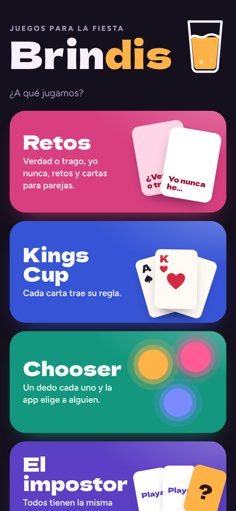
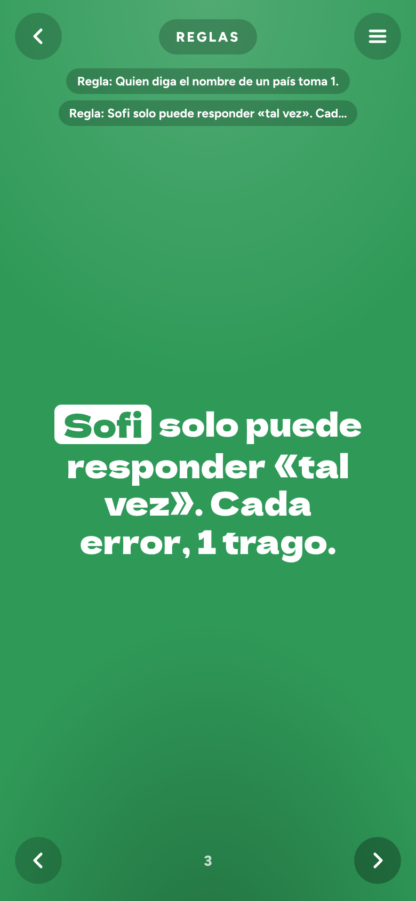
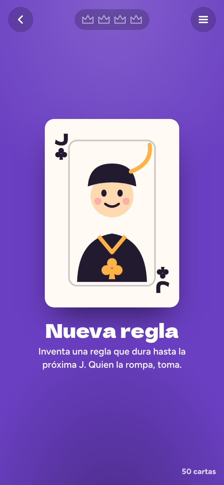
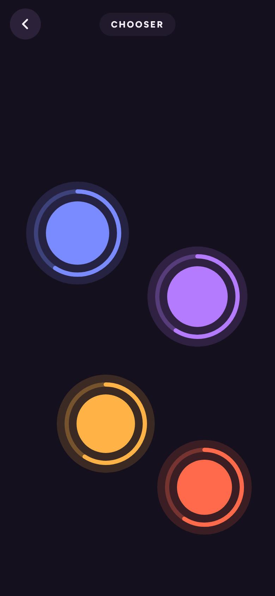
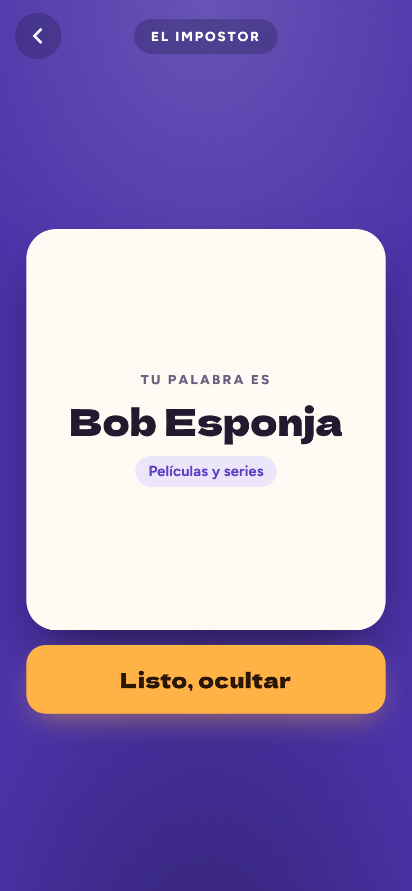
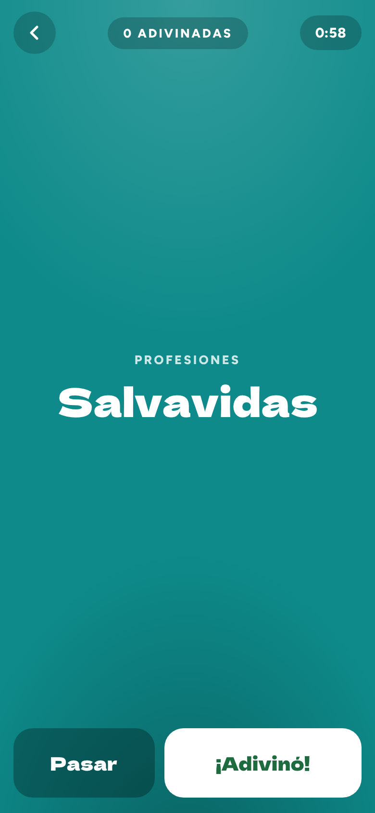

# Brindis

Brindis es una web app con cinco juegos para la fiesta. Se juega con un solo celular que pasa de mano en mano, está en español y funciona sin internet después de abrirla la primera vez.

**Jugar:** https://joseh1105.github.io/PartyGames/

  
  
  

  
  
  

## Juegos

- **Retos.** Agregan a los jugadores, marcan quiénes son pareja y eligen categorías: Rompehielo, Graciosos, Yo nunca, ¿Quién es más probable?, Verdad o trago, Retos, Temas, ¿Qué prefieres?, Confesiones, Parejas, Atrevidos +18 y Reglas. Son más de 600 cartas y salen en orden aleatorio, sin repetirse hasta que se acaba el mazo.
- **Kings Cup.** Baraja de 52 cartas dibujadas, cada una con su regla. Lleva la cuenta de los reyes y se puede ocultar la explicación de cada carta.
- **Chooser.** Todos ponen un dedo en la pantalla y, cuando nadie más se suma, la app escoge a una persona.
- **El impostor.** Todos reciben la misma palabra menos el impostor. El celular pasa de uno en uno y cada quien ve solo la suya. Trae unas 300 palabras en 9 categorías, incluida una de Costa Rica.
- **Adivina quién soy.** Quien adivina se pone el celular en la frente y los demás le dan pistas. Hay 6 categorías (videojuegos, anime, televisión, películas, famosos y profesiones) con 52 identidades cada una, y se puede jugar con tiempo o sin límite.

## Instalarla en el celular

**iPhone (Safari)**
1. Abre el enlace en Safari.
2. Toca el botón de compartir.
3. Elige **Agregar a pantalla de inicio**.

**Android (Chrome)**
1. Abre el enlace en Chrome.
2. Toca el menú ⋮.
3. Elige **Instalar app** o **Agregar a pantalla principal**.

Queda un ícono en la pantalla de inicio y la app se abre a pantalla completa, sin la barra del navegador. Cuando hay internet, descarga sola la versión más nueva.

## Archivos

| Archivo | Para qué sirve |
| --- | --- |
| `index.html` | Toda la app (HTML, CSS y JavaScript en un solo archivo) |
| `manifest.webmanifest`, `icons/` | Nombre e ícono para instalarla |
| `sw.js` | Guarda la app para usarla sin conexión |
| `screenshots/` | Capturas de este README |

Para que los celulares que ya la tienen instalada reciban un cambio, sube también el número de `CACHE` en `sw.js` (por ejemplo, de `brindis-v1` a `brindis-v2`).

Tomen con responsabilidad. Si toman, nadie maneja.
